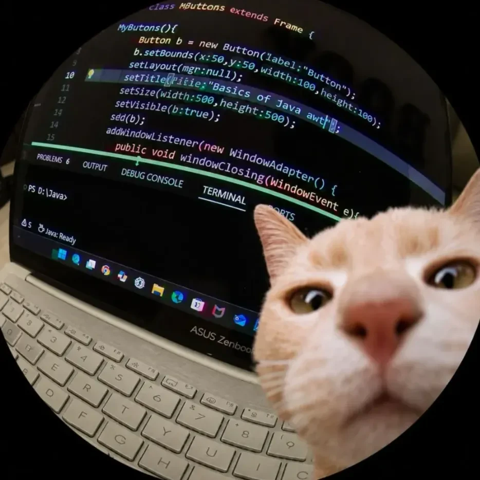

<p align="center"></p>

<h1 align="center">SwitchTR Manager</h1>

<p align="center">
Nintendo Switch Türkçe Sistem Yaması için kurulum ve güncelleme aracı<br>
Installer and updater for the Nintendo Switch Turkish System Patch
</p>

---

## Türkçe

**SwitchTR Manager**, Pasha Bey'in hazırladığı [SwitchTR](https://github.com/pextechh/SwitchTR) Türkçe sistem yamasını Switch üzerinden kurmanı ve güncel tutmanı sağlayan bir homebrew uygulamasıdır.

### Özellikler
- **Güncelleme takibi:** GitHub'daki yeni yama sürümlerini denetler.
- **Otomatik kurulum:** Konsolun bölgesini algılar, uygun paketi (Avrupa / Amerika) indirir, SHA-256 ile doğrular ve `atmosphere/contents` altına kurar.
- **Manuel kurulum:** Sürümü ve bölge paketini kendin seçersin.
- **SD karttan kurulum:** `sdmc:/switch/SwitchTR/` klasörüne koyduğun zip'ten internetsiz kurar.
- **Temiz kaldırma:** Yalnızca uygulamanın kurduğu dosyaları siler; aynı klasörlerdeki temalara dokunmaz.
- **Uyarılar:** Sistem dili İngilizce değilse ya da sistem sürümü desteklenmiyorsa uyarır.
- **Arayüz:** KernelSU tarzı arayüz; Türkçe ve İngilizce dil seçeneği, dokunmatik ve kontrolcü desteği.

### Kurulum
1. [Releases](../../releases) sayfasından `SwitchTR-Manager.nro` dosyasını indir.
2. SD kartında `switch/` klasörüne kopyala.
3. Homebrew Menu'den aç.

### Gereksinimler
- Atmosphère CFW.
- Sistem sürümü 20.0.0 – 23.0.1.
- Sistem dili İngilizce (yama İngilizce dil dosyalarının yerine geçer).

### Kontroller
| Tuş | İşlev |
|---|---|
| A | Seç |
| B | Geri |
| L / R | Sekme değiştir |
| X | Dil (TR / EN) |
| Y | Sürümleri yenile |
| + | Çıkış |

---

## English

**SwitchTR Manager** is a homebrew app for installing and updating the [SwitchTR](https://github.com/pextechh/SwitchTR) Turkish system patch by Pasha Bey, right from your Switch.

### Features
- **Update tracking:** checks GitHub for new patch releases.
- **Automatic install:** detects your console region, downloads the matching package (Europe / Americas), verifies it with SHA-256 and installs it to `atmosphere/contents`.
- **Manual install:** pick the release and region package yourself.
- **Offline install:** install from a zip placed in `sdmc:/switch/SwitchTR/`.
- **Clean removal:** deletes only the files the app installed.
- **Interface:** KernelSU-style UI in Turkish and English; touch and controller support.

### Requirements
- Atmosphère CFW.
- System version 20.0.0 – 23.0.1.
- System language set to English.

---

## Derleme / Building

[devkitPro](https://devkitpro.org/wiki/Getting_Started) ile:

```bash
dkp-pacman -S switch-dev switch-sdl2 switch-sdl2_ttf switch-curl switch-jansson switch-zlib
make
```

Her `v*` etiketinde GitHub Actions NRO'yu derleyip sürüme ekler.
Every `v*` tag is built by GitHub Actions and attached to a release.

İkon, logolar ve QR kodları `tools/make_assets.py` ile üretilir (Pillow ve qrcode gerekir).

## Emeği geçenler / Credits

| | |
|---|---|
|  | **miyqwx** — uygulama geliştiricisi / app developer · [github.com/miyqwx-dev](https://github.com/miyqwx-dev) |
|  | **Pasha Bey** — Türkçe yama / Turkish patch · [github.com/pextechh/SwitchTR](https://github.com/pextechh/SwitchTR) |

## Lisans / License

Kaynak kod [MIT lisansı](LICENSE) ile dağıtılır. Logolar ve ikon bu lisansa dahil değildir; sahiplerine aittir (ayrıntılar [LICENSE](LICENSE) dosyasında).

The source code is released under the [MIT License](LICENSE). Logos and the icon are not covered by it and belong to their respective owners (see [LICENSE](LICENSE)).

Bu proje Nintendo ile bağlantılı değildir. Nintendo Switch, Nintendo Co., Ltd.'nin ticari markasıdır.
This project is not affiliated with Nintendo.
